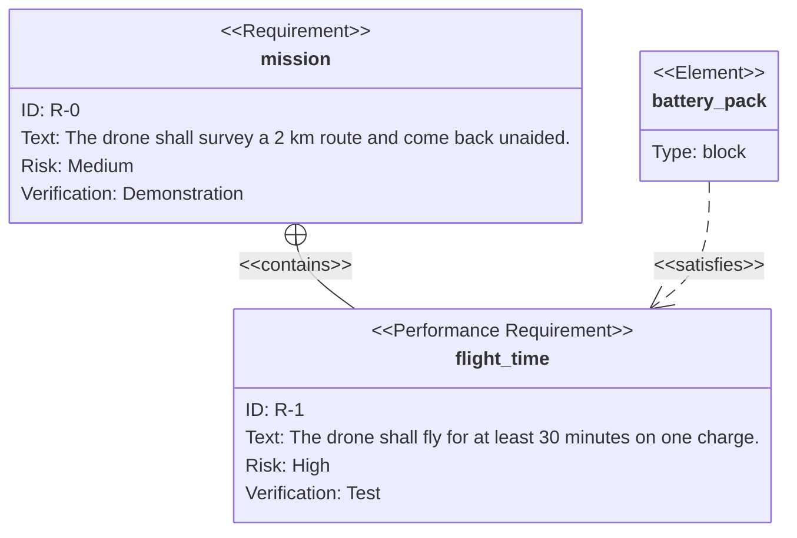

# SysML — requirements, blocks, states and activities

Archyne edits SysML the way it edits UML: as Mermaid, with the canvas as a
view over the text. Mermaid has no single "SysML" diagram, so SysML arrives in
two ways:

| SysML diagram                | Written as                      | In Archyne                           |
| ---------------------------- | ------------------------------- | ------------------------------------ |
| **Requirement diagram**      | `requirementDiagram`            | its own family, edited visually      |
| **Block definition diagram** | `classDiagram` with `<<block>>` | the class family, and a template     |
| **State machine**            | `stateDiagram-v2`               | the state family, and a template     |
| **Activity**                 | `flowchart`                     | the flowchart family, and a template |
| Sequence                     | `sequenceDiagram`               | the sequence family                  |

The requirement diagram is the one part of SysML Mermaid draws natively, and
it is a family of its own here — palette, inspector, round-trip, export —
exactly as class, state and sequence diagrams are. The other SysML diagrams
are SysML _notation_ written in the UML family that draws it, so they are
edited as that family is; the templates show how.

## The requirement diagram

### What a node can be

Seven kinds, each named by the keyword that opens its block — which is also
what the palette offers and what the inspector's **Kind** switches between:

| Keyword                  | Palette                 |
| ------------------------ | ----------------------- |
| `requirement`            | Requirement             |
| `functionalRequirement`  | Functional requirement  |
| `interfaceRequirement`   | Interface requirement   |
| `performanceRequirement` | Performance requirement |
| `physicalRequirement`    | Physical requirement    |
| `designConstraint`       | Design constraint       |
| `element`                | Element                 |

A **requirement** of any kind carries an id, a text, a risk (`low`, `medium`,
`high`) and a verification method (`analysis`, `demonstration`, `inspection`,
`test`). An **element** — the block, test case or simulation that answers a
requirement — carries a type and a document reference. Every field is
optional, and one left empty is not written to the file at all.

On the canvas a node is drawn as SysML draws it: the kind in guillemets over
the name, then one `Label: value` row per field it has — `Id`, `Text`, `Risk`,
`Verification` for a requirement, `Type`, `Doc ref` for an element. Those row
labels stay in English in every locale: they are SysML's vocabulary and the
words Mermaid itself draws, and an exported picture should not change its
words with the editor's language.

### Relationships

| Relationship | Drawn as                                          |
| ------------ | ------------------------------------------------- |
| `contains`   | solid line, crosshair circle at the container end |
| `copies`     | dashed line, open arrowhead, `«copies»`           |
| `derives`    | dashed line, open arrowhead, `«derives»`          |
| `satisfies`  | dashed line, open arrowhead, `«satisfies»`        |
| `verifies`   | dashed line, open arrowhead, `«verifies»`         |
| `refines`    | dashed line, open arrowhead, `«refines»`          |
| `traces`     | dashed line, open arrowhead, `«traces»`           |

The relationship is the label: Mermaid's syntax has no room for any other text
on the line, so the inspector offers a **Relationship** choice where other
families offer a free-text label. A connection drawn on the canvas starts as
`satisfies`. The canvas and the exported SVG share one set of markers
(`src/render/markers.ts`), so they draw the same crosshair.

### Editing

- **From the palette**, a requirement arrives as `Requirement1`,
  `Requirement2`, … with a placeholder text, and an element as `Element1`, …
  of type `block`.
- **The name is the identifier.** Unlike a class or a state, a requirement has
  no alias in this syntax, so renaming one — on the canvas or in the
  inspector — renames every relationship that points at it. The name changes
  when the edit is committed (on leaving the field), not on every keystroke.
- **A name another node already has is refused**, and the old name stays: two
  requirements with one name are one requirement to Mermaid, and merging them
  silently would lose one.
- **Colours** work as in the other families: the inspector writes a
  `style <name> …` line, and `classDef` / `class` lines are kept.
- **Direction** (`direction LR`, …) is offered from the toolbar.

### What the file looks like after an edit

The serializer writes one canonical form, and a file already in that form
comes back byte for byte. In order:

1. `requirementDiagram`, then `direction …` unless it is top-to-bottom;
2. the requirements, then the elements, each with its fields in a fixed order
   (`id`, `text`, `risk`, `verifymethod`; `type`, `docref`). An empty body is
   still written as `{` … `}` — Mermaid requires the braces;
3. a blank line, then one `a - rel -> b` line per relationship. One written
   the other way round (`b <- rel - a`) comes back in this direction: it is
   the same relationship;
4. a blank line, then `classDef`, `class` and `style` lines.

Details worth knowing:

- **Names** are written bare when they are plain identifiers (`flight_time`)
  and quoted otherwise (`"Top speed"`, `"REQ-1.2"`) — the syntax cannot take
  `-` or `.` in a bare name.
- **Field values** are always quoted, since texts routinely carry colons and
  commas; `risk` and `verifymethod` are written in lower case.
- **Double quotes** cannot be escaped inside a quoted value or name, so a `"`
  becomes `'`. Line breaks in a text become spaces.
- **Class colours stay on the class.** Mermaid folds a `classDef`'s
  declarations into each member's own style list; Archyne takes them back out,
  so a member of `hot` does not acquire a `style` line repeating `hot`'s
  colours.

The positions comment (`%% graph:positions`) works as in every family, keyed
by name.

## The templates

**Templates** offers four SysML starting points, all describing one small
drone so that together they read as a model rather than four unrelated
pictures:

| Template               | Family      | What it shows                                                                          |
| ---------------------- | ----------- | -------------------------------------------------------------------------------------- |
| SysML requirements     | requirement | requirements derived and contained, satisfied by blocks, verified by a test case       |
| SysML block definition | class       | `<<block>>` classes with `part`, `value` and `port` rows, composed with multiplicities |
| SysML state machine    | state       | operating modes, with flight as a composite state                                      |
| SysML activity         | flowchart   | initial and final nodes, actions, a decision and a merge                               |

In the block definition diagram, SysML's compartments are written as
members — `part frame : Airframe`, `value mass : kg`, `port charge : DCPort` —
and the stereotype is a class annotation. Any stereotype can be typed into
the class inspector's annotations field (`block`, `valueType`,
`interfaceBlock`, `constraintBlock`, …), separated by spaces; brackets typed
around a name are taken off, since the file writes them itself.

## Limits

- **Activity diagrams have no fork or join bar.** Mermaid's flowchart has no
  such shape, so the activity template uses a decision and a merge rather than
  draw a black box and call it a bar.
- **Requirement rows do not wrap.** A long text makes a wide node; resizing it
  does not reflow the rows.
- **No double quotes** in names or texts, as above.
- **Parametric, package, internal block and use-case diagrams** have no Mermaid
  counterpart and are not offered.

## Where it lives

| Concern                                | File                                                                                                |
| -------------------------------------- | --------------------------------------------------------------------------------------------------- |
| Node and edge types, `requirementRows` | `src/model/types.ts`                                                                                |
| Parse and serialize                    | `src/model/kinds/requirement.ts`                                                                    |
| Dispatch, edge presentation, defaults  | `src/model/diagram.ts`                                                                              |
| Rename-follows-references, new nodes   | `src/store.ts` (`renameRequirements`, `addNode`)                                                    |
| Canvas node                            | `src/components/KindNodes.tsx` (`RequirementNodeView`)                                              |
| Palette and inspector                  | `src/components/Palette.tsx`, `src/components/Inspector.tsx`                                        |
| Measurement without a browser          | `src/measureNode.ts`                                                                                |
| SVG export, containment marker         | `src/render/renderSvg.ts`, `src/render/markers.ts`                                                  |
| Templates                              | `src/templates.ts`                                                                                  |
| Tests                                  | `src/model/roundtrip.test.ts`, `src/store.test.ts`, `tests/e2e-measure.mts`, `tests/e2e-render.mts` |
